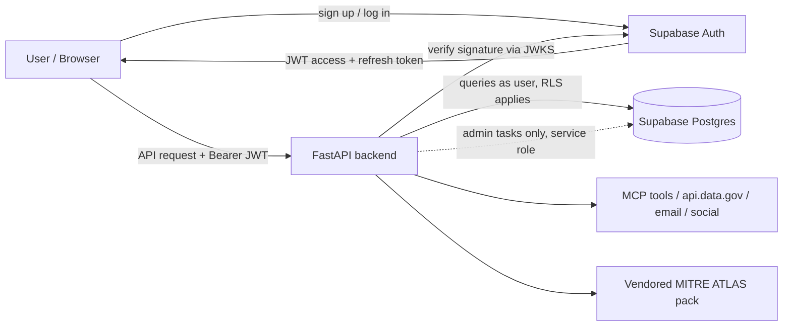
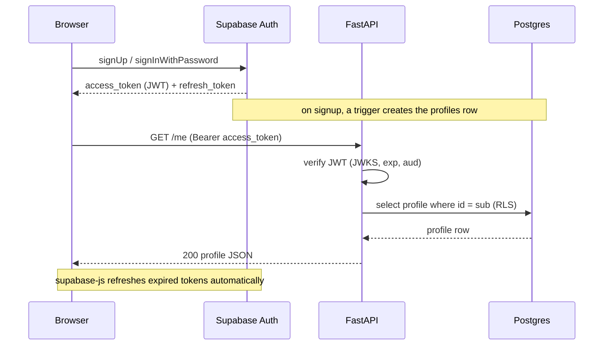

# HomeFront Architecture

> Status: **Draft template**. Sections marked `TODO` still need decisions from the team.
> Last updated: 2026-11-07

## 1. Overview

**What HomeFront does:** TODO, one or two sentences on the product and who uses it.

**Core user flows:**
1. A user signs up or logs in.
2. A user views and edits their profile.
3. An operator authenticates an AI agent, allows selected MCP tools, revokes mid-task, and sees MITRE ATLAS-tagged denials.
4. TODO: additional agency workflows (email / social / scrape / data.gov).

## 2. Tech Stack

| Layer          | Choice                                   | Notes                                              |
|----------------|------------------------------------------|----------------------------------------------------|
| Frontend       | React 18 + Vite (`Frontend/`)            | `supabase-js` for auth; all API calls via `src/lib/api.js` |
| Backend API    | FastAPI (Python)                         | Single service. Flask dropped (see §9)             |
| Auth           | Supabase Auth                            | Issues JWTs. The backend never handles passwords   |
| Database       | Supabase Postgres                        | Row Level Security (RLS) turned on                 |
| File storage   | TODO (Supabase Storage / S3)             | Avatars, uploads                                   |
| Hosting        | TODO (AWS: App Runner / ECS / Lambda)    | AWS x A10 hackathon                                |
| Secrets        | `.env` locally, TODO in prod (AWS Secrets Manager) | Never commit `.env`                      |

## 3. System Diagram



## 4. Components

### 4.1 Frontend
- Handles sign-up, login, logout, password reset and OAuth through `supabase-js`.
- Stores the session (Supabase manages refresh tokens).
- Sends `Authorization: Bearer <access_token>` with every backend request.
- Holds **only** the Supabase URL and the anon key.

### 4.2 Supabase Auth
- Source of truth for identities (`auth.users`).
- Enabled providers: email/password, TODO (Google, GitHub, magic link?).
- Email confirmation required? TODO.

### 4.3 FastAPI Backend
- Stateless. Reads the user's identity from the JWT on every request.
- Auth dependency: checks the signature, expiry and audience (`authenticated`), then exposes `user_id = sub`.
- Business logic lives here. TODO: list the domain modules.
- Uses the **anon key + user JWT** for user-scoped queries, so RLS applies.
- Uses the **service role key** only for admin or background jobs, which bypass RLS.

### 4.4 Database (Supabase Postgres)
- `auth` schema: managed by Supabase. Don't modify it.
- `public` schema: application tables, all with RLS turned on.
- Database trigger: when a new user is created in `auth.users`, a matching `public.profiles` row is created.

## 5. Authentication Flow



**Token rules**
- Access token lifetime: TODO (Supabase default is 1 hour).
- The backend rejects missing, expired or invalid tokens with `401`.
- Authorization (roles/permissions): TODO. Options are a `role` column on profiles or custom JWT claims.

## 6. Data Model

### `public.profiles`
| Column       | Type        | Constraints                                   |
|--------------|-------------|-----------------------------------------------|
| id           | uuid        | PK, FK → `auth.users.id`, cascade delete      |
| username     | text        | unique, nullable                              |
| full_name    | text        |                                               |
| avatar_url   | text        |                                               |
| role         | text        | TODO: default `user`?                         |
| created_at   | timestamptz | default now()                                 |
| updated_at   | timestamptz | default now()                                 |

**RLS policies**
- Select: a user can read their own row. TODO: are profiles public?
- Update: a user can update their own row only.
- Insert/Delete: only the signup trigger and cascade, not clients.

### `public.agents`
User-defined agents. Read and written by the gateway with the service role (`AGENT_STORE=supabase`).

| Column        | Type        | Constraints / notes                                         |
|---------------|-------------|-------------------------------------------------------------|
| id            | text        | PK, `^[a-z0-9][a-z0-9-]{2,63}$` (used in URLs)              |
| owner_id      | uuid        | FK → `auth.users.id`, cascade delete. null = demo/system    |
| name / agency | text        | 1–80 / 1–120 chars                                          |
| instructions  | text        | ≤ 8000 chars. The agent's purpose and system prompt         |
| model         | text        | null = runner default                                       |
| max_steps     | integer     | 1–50, default 10. Caps turns per run (AML.T0034)            |
| tool_grants   | text[]      | Tool names, checked against `TOOL_REGISTRY` by the API      |
| token_version | integer     | Bumped on grant changes to invalidate workload tokens       |
| active        | boolean     | Inactive agents can't get tokens                            |
| created_at / updated_at | timestamptz | `updated_at` set by trigger                         |

**RLS policies:** owners can select, insert, update and delete their own rows. Rows with no owner are visible only to the service role.

Workload tokens and the audit log are still in memory.

**API access** (`/agents*`, `/auth/token`, `/audit`): a signed-in user gets their own agents plus ownerless demo agents, and new agents are owned by the creator. Anonymous callers (only when `AGENT_ADMIN_REQUIRES_LOGIN=false`) get ownerless agents only. Other users' agents return `404`. An invalid user token is always `401`.

### Domain tables
TODO: list HomeFront's own tables. Every table that belongs to a user should have a `user_id uuid references auth.users(id)` column and an RLS policy on it.

## 7. API Surface (v1)

| Method | Path             | Auth     | Purpose                         |
|--------|------------------|----------|---------------------------------|
| GET    | `/health`        | none     | Liveness check                  |
| GET    | `/me`            | required | Current user's profile          |
| PATCH  | `/me`            | required | Update own profile              |
| GET    | `/profiles/{id}` | TODO     | Public profile lookup (if any)  |
| TODO   | TODO             | required | HomeFront domain endpoints      |

Conventions: JSON only, Pydantic models for requests and responses, errors shaped as `{"detail": "..."}`, prefix routes with `/api/v1`.

## 8. Project Structure (planned)

```
HomeFront/
├── Backend/
│   ├── app/
│   │   ├── main.py            # app factory, CORS, routers
│   │   ├── core/
│   │   │   ├── config.py      # env settings
│   │   │   ├── auth.py        # JWT verification dependency
│   │   │   └── supabase.py    # client factories (user-scoped / admin)
│   │   ├── routers/           # profiles.py, health.py, <domain>.py
│   │   ├── schemas/           # Pydantic models
│   │   └── services/          # business logic
│   ├── tests/
│   ├── requirements.txt
│   └── .env.example
├── supabase/
│   └── migrations/            # SQL: tables, RLS policies, triggers
├── Frontend/                  # TODO
├── docs/
│   └── ARCHITECTURE.md
└── README.md
```

## 9. Key Decisions

| # | Decision                                   | Reason                                                       |
|---|--------------------------------------------|--------------------------------------------------------------|
| 1 | Supabase Auth instead of custom auth       | Secure defaults, OAuth included, no password handling       |
| 2 | FastAPI only (no Flask)                    | One auth layer and one deploy. Async and Pydantic built in   |
| 3 | Profiles in `public.profiles`, linked 1:1 to `auth.users` | Keeps app data separate from managed auth tables |
| 4 | RLS on every public table                  | Protection in depth, even if the API has a bug               |
| 5 | Schema changes only through migration files | Every teammate's database matches                           |

## 10. Configuration

| Variable                    | Used by           | Secret? |
|-----------------------------|-------------------|---------|
| `SUPABASE_URL`              | frontend, backend | no      |
| `SUPABASE_ANON_KEY`         | frontend, backend | no (public) |
| `SUPABASE_SERVICE_ROLE_KEY` | backend only      | **yes** |
| `SUPABASE_JWT_SECRET`       | backend (legacy HS256 projects only) | **yes** |
| `ALLOWED_ORIGINS`           | backend (CORS)    | no      |

## 11. Security Checklist
- [ ] `.env` is in `.gitignore`
- [ ] Service role key never reaches the frontend or logs
- [ ] RLS turned on and tested for every `public` table
- [ ] CORS limited to known frontend origins
- [ ] JWT checks cover audience and expiry, not just signature
- [ ] Rate limiting on public endpoints (TODO)

## 12. Open Questions
- TODO: Which OAuth providers?
- TODO: Do we need roles or admin users?
- TODO: Where in AWS do we deploy the backend?
- TODO: Are profiles public or private?
