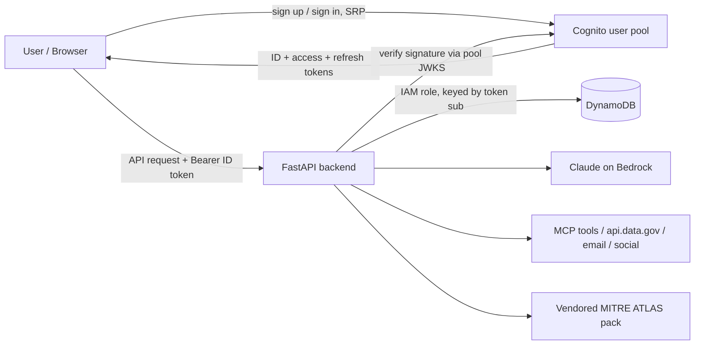
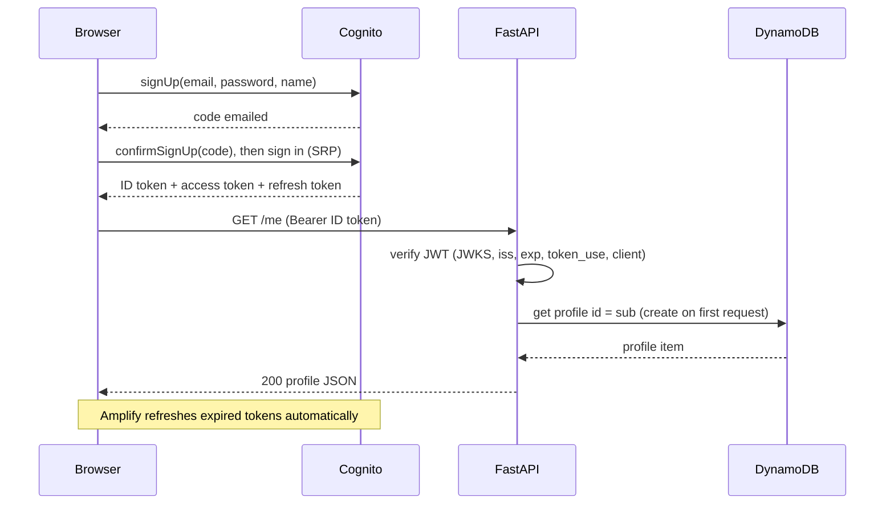

# HomeFront Architecture

> **Merge note (Lead, 2026-11-07):** this draft describes the teammates' pre-merge design (Amplify sign-in,
> profiles and agents tables, per-tool grants, `/auth/token`, the Bedrock runner). Those routes are not part of
> the merged app. The enforced path is the mandate broker + `/mcp` + `guarded()`: see
> `packages/identity-gateway/README.md` and `docs/LANES.md`.

> Status: **Draft template**. Sections marked `TODO` still need decisions from the team.
> Last updated: 2026-11-07 (moved from Supabase to Amazon Cognito + DynamoDB)

## 1. Overview

**What HomeFront does:** TODO, one or two sentences on the product and who uses it.

**Core user flows:**
1. A user signs up (confirming their email with a code) or signs in.
2. A user views and edits their profile.
3. A user creates agents, grants them MCP tools, and runs them on Claude (Amazon Bedrock).
4. An operator authenticates an AI agent, allows selected MCP tools, revokes mid-task, and sees MITRE ATLAS-tagged denials.

## 2. Tech Stack

| Layer          | Choice                                   | Notes                                              |
|----------------|------------------------------------------|----------------------------------------------------|
| Frontend       | React 18 + Vite (`Frontend/`)            | Amplify Auth (`aws-amplify/auth`) for sign-in; all API calls via `src/lib/api.js` |
| Backend API    | FastAPI (Python)                         | Single service. Flask dropped (see §9)             |
| Auth           | Amazon Cognito user pool                 | Issues JWTs. The backend never handles passwords   |
| Database       | Amazon DynamoDB (on-demand)              | Only the backend's IAM role can reach the tables   |
| Agent model    | Claude on Amazon Bedrock                 | See README "Running agents"                        |
| Infrastructure | CloudFormation (`infra/cloudformation/homefront.yaml`) | Deployed with `infra/deploy.sh`       |
| File storage   | TODO (S3)                                | Avatars, uploads                                   |
| Hosting        | TODO (AWS: App Runner / ECS / Lambda)    | AWS x A10 hackathon                                |
| Secrets        | `.env` locally, TODO in prod (AWS Secrets Manager) | Never commit `.env`                      |

## 3. System Diagram



## 4. Components

### 4.1 Frontend
- Handles sign-up, email-code confirmation, sign-in and sign-out through Amplify Auth (`src/lib/AuthProvider.jsx`).
- Amplify stores the tokens and refreshes them; `getIdToken()` always returns a current one.
- Sends `Authorization: Bearer <id_token>` with every backend request.
- Holds **only** the user pool id and app client id. Both are public; the client has no secret.

### 4.2 Amazon Cognito
- Source of truth for identities. The user's id everywhere is the token's `sub`.
- Sign-in with email + password (SRP, so the password never leaves the browser). Email confirmation required, by code.
- Password policy: 8+ characters with a lowercase letter and a number.
- Emails go through Cognito's built-in sender (a few per day). TODO: switch to SES before real users.
- Enabled providers: email/password. TODO: Google, GitHub (Cognito federation)?

### 4.3 FastAPI Backend
- Stateless. Reads the user's identity from the JWT on every request (`app/core/auth.py`).
- Auth dependency checks the RS256 signature against the pool's JWKS, the issuer (this pool), expiry, `token_use`, and the app client (`aud` for ID tokens, `client_id` for access tokens). Then exposes `user_id = sub`.
- Every DynamoDB read and write is keyed by that verified `sub` (profiles) or checked against the agent's `owner_id` (agents). This replaces Supabase RLS.

### 4.4 Database (DynamoDB)
- Six tables, named `<DYNAMODB_TABLE_PREFIX><name>`: `profiles`, `usernames`, `agents`, `audit`, `approvals`, `reports` (§6).
- Key schemas are defined once in `Backend/app/core/dynamodb.py` and mirrored in the CloudFormation template; `Backend/tests/test_infra.py` fails if they drift.
- Browsers never talk to DynamoDB. The `BackendDataPolicy` IAM policy (stack output) grants the backend access to these tables only.
- Local development: DynamoDB Local via `scripts/run-dynamodb-local.sh`.

## 5. Authentication Flow



**Token rules**
- ID and access tokens last 60 minutes; refresh tokens 30 days (set in the template).
- The backend rejects missing, expired or invalid tokens with `401`, and returns `503` if Cognito isn't configured.
- Authorization (roles/permissions): TODO. Options are a `role` attribute on profiles or Cognito groups (`cognito:groups` claim).

## 6. Data Model

### `profiles` (pk `id`)
| Attribute    | Type   | Notes                                                    |
|--------------|--------|----------------------------------------------------------|
| id           | S      | Cognito `sub`                                            |
| username     | S/NULL | Unique (reserved in `usernames`), 3–32 chars             |
| full_name    | S/NULL | From the Cognito `name` attribute at first sign-in       |
| avatar_url   | S/NULL |                                                          |
| role         |        | TODO: default `user`?                                    |
| created_at / updated_at | S | ISO 8601 UTC                                    |

- Created by the first authenticated `GET /me` or `PATCH /me` (conditional put, so two first requests can't clobber each other). This replaces the Postgres signup trigger.
- Users can only read and update their own profile: the API keys every call by the token's `sub`.

### `usernames` (pk `username`)
Reservation rows `{username, user_id}`. Setting a username writes the reservation, releases the old one and updates the profile in one `TransactWriteItems`. A taken name returns `409`. Usernames are case-sensitive, as before.

### `agents` (pk `id`)
User-defined agents. Read and written by the gateway (`AGENT_STORE=dynamodb`). Reads are strongly consistent, so a revoke applies to the very next tool call.

| Attribute     | Type    | Notes                                                       |
|---------------|---------|-------------------------------------------------------------|
| id            | S       | `^[a-z0-9][a-z0-9-]{2,63}$` (used in URLs)                  |
| owner_id      | S/NULL  | Cognito `sub`. null = shared demo agent                     |
| kind          | S       | `email` / `social` / `research` / `market_research` / `custom`. Fixed at creation; missing = `custom` |
| name / agency | S       | 1–80 / 1–120 chars                                          |
| instructions  | S       | ≤ 8000 chars. The agent's purpose and system prompt         |
| model         | S/NULL  | null = runner default                                       |
| max_steps     | N       | 1–50, default 10. Caps turns per run (AML.T0034)            |
| tool_grants   | L       | Tool names, checked against `TOOL_REGISTRY` by the API      |
| scrape_domains | L      | `web.scrape` allowlist: `sam.gov` (exact) or `*.gov` (domain + subdomains), ≤ 50. Empty/missing = any public host. Default `["*.gov"]` for `market_research`. Widening bumps `token_version`; narrowing applies to the next call |
| token_version | N       | Bumped on grant changes to invalidate workload tokens       |
| active        | BOOL    | Inactive agents can't get tokens or run                     |
| created_at / updated_at | S | ISO 8601 UTC                                      |

**Agent types** (`packages/identity-gateway/src/identity_gateway/agent_types.py`, public catalog at `GET /agent-types`): each kind supplies default instructions, tools and `max_steps` for fields left out of `POST /agents`, plus a tool ceiling. Email: `email.send`, `datagov.search`. Social: `social.post`, `social.reply`. Research: `web.scrape`, `datagov.search`, never an outbound tool, because it reads untrusted content. Procurement market research (`market_research`, FAR Part 10): `web.scrape`, `datagov.search`, `usaspending.search`, `sam.entity_lookup`, `report.save`, also never outbound; its `scrape_domains` default to `["*.gov"]`. `custom` has no ceiling. Granting a tool outside the ceiling returns `403 tool_not_allowed_for_kind` and is audited as `grant_denied`. `/mcp/call` checks the ceiling again, so a grant written straight to the table is still blocked.

The field limits are enforced by the API's request models (DynamoDB has no check constraints). The demo agent `agent-comms-01` is seeded at startup if missing.

**API access** (`/agents*`, `/auth/token`, `/audit`): a signed-in user gets their own agents plus ownerless demo agents, and new agents are owned by the creator. Anonymous callers (only when `AGENT_ADMIN_REQUIRES_LOGIN=false`) get ownerless agents only. Other users' agents return `404`. An invalid user token is always `401`.

**Gateway checks on every tool call** (`call_tool` in `identity_gateway/app.py`, in order): secret probe → type ceiling → grant → taint → scrape domain → mailing list → human approval → run.
- **Taint tracking** (information-flow control): tools carry `untrusted_input` (returns external content: `web.scrape`, `usaspending.search`, `sam.entity_lookup`; `social.reply` is flagged too but only runs after approval, so it never taints) and `outbound` (`email.send`, `email.send_list`, `social.post`, `social.reply`) flags. After an `untrusted_input` tool *executes* in a trace (run id, or token session for manual `/mcp/call`), every outbound call in that trace is denied `403 tainted_session`, audited with AML.T0051.001 / AML.T0086 and AML.M0030. This applies to every type, including `custom`. A new run or token session starts clean. Approvals are not re-checked against taint: a request can only be created while its trace is clean, so its arguments predate the untrusted content, and a person reviews them.
- **Scrape domains** (argument-level authorization): if `scrape_domains` is set, `web.scrape` to any other host is denied `403 domain_not_allowed` (audited); the handler also checks live redirects against it.
- **SSRF guard** (`mcp_tools/handlers.py`): `web.scrape` refuses non-http(s) schemes, credentials in URLs, localhost names and any private, loopback, link-local (incl. 169.254.169.254), multicast, reserved or unspecified address, resolving DNS on live fetches and re-checking each redirect. The result is `status: denied` with an ATLAS note (AML.M0033).

Workload tokens, taint state and agent run records are still in memory.

### `audit` (pk `agent_id`, sk `<ts>#<id>`)
The activity log: one item per gateway decision or agent change (`identity_gateway/audit.py`). Each event has a `trace_id` (the run id, or the workload-token session id for manual MCP calls), an `actor` (`user:<sub>`, `agent:<id>` or `anonymous`), a `decision` and compact ATLAS ids. Queried newest-first per agent through `GET /audit?agent_id=&trace_id=&decision=&type=`. Items expire after 90 days (`expires_at` TTL). A failed write is kept in memory and counted in `GET /status`.

### `approvals` (pk `id`)
Human approval for tools with `requires_hitl` (`email.send`, `social.post`, `social.reply`; `identity_gateway/approvals.py`, ATLAS AML.M0029). The gateway does not run these tools on a call: it stores a `pending` approval and returns `pending_approval` to the agent. A signed-in user approves (optionally editing the arguments, which must still match the tool schema) or rejects through `/approvals/{id}/approve|reject`. Approval re-checks the grant, the agent type and `active`, so a revoke after the request blocks it. Status leaves `pending` exactly once (conditional write), so a request can't be sent twice; requests expire after 24 hours. `/approvals` is a user-only route: an agent's workload token can't approve its own request.

### `reports` (pk `agent_id`, sk `<ts>#<id>`)
Markdown reports agents save with `report.save` (`identity_gateway/reports.py`): `report_id`, `title` (≤ 200), `body` (≤ 50 000), `trace_id`, `run_id`, `created_at`. The agent id comes from the caller's workload token, never from arguments. Listed newest-first through `GET /agents/{id}/reports`, owner-scoped like other `/agents` routes.

`GET /status` reports which store (DynamoDB or memory) agents, the activity log, approvals and reports are using, plus any startup fallback warnings.

### Domain tables
TODO: list HomeFront's own tables. Add each to `TABLES` in `Backend/app/core/dynamodb.py` **and** the CloudFormation template (plus the IAM policy). Every item that belongs to a user should carry the owner's `sub`, and every access should check it.

## 7. API Surface (v1)

| Method | Path             | Auth     | Purpose                         |
|--------|------------------|----------|---------------------------------|
| GET    | `/health`        | none     | Liveness check                  |
| GET    | `/me`            | required | Current user's profile (created on first call) |
| PATCH  | `/me`            | required | Update own profile (`409` if username taken) |
| GET    | `/profiles/{id}` | TODO     | Public profile lookup (if any)  |
| *      | `/agents...`     | see §6   | Agents, grants, runs            |

Conventions: JSON only, Pydantic models for requests and responses, errors shaped as `{"detail": "..."}`, prefix routes with `/api/v1`.

## 8. Project Structure

```
HomeFront/
├── Backend/
│   ├── app/
│   │   ├── main.py            # app factory, CORS, routers
│   │   ├── agent_iam.py       # mounts the agent gateway, wires DynamoDB + Bedrock
│   │   ├── core/
│   │   │   ├── config.py      # env settings
│   │   │   ├── auth.py        # Cognito JWT verification dependency
│   │   │   └── dynamodb.py    # table definitions + boto3 resource
│   │   ├── routers/           # profiles.py, health.py, <domain>.py
│   │   ├── schemas/           # Pydantic models
│   │   └── services/          # business logic (profiles.py)
│   ├── tests/
│   ├── requirements.txt
│   └── .env.example
├── infra/
│   ├── cloudformation/homefront.yaml   # Cognito, DynamoDB, IAM policy
│   └── deploy.sh
├── packages/identity-gateway/ # agent identity, grants, runner (dynamo_repo.py)
├── Frontend/
├── docs/
│   └── ARCHITECTURE.md
└── README.md
```

## 9. Key Decisions

| # | Decision                                   | Reason                                                       |
|---|--------------------------------------------|--------------------------------------------------------------|
| 1 | Cognito instead of custom auth             | Managed passwords and email verification; AWS-native for the hackathon |
| 2 | FastAPI only (no Flask)                    | One auth layer and one deploy. Async and Pydantic built in   |
| 3 | Profiles keyed by Cognito `sub`, separate from Cognito attributes | App data stays in our table; Cognito stays the identity source |
| 4 | Only the backend touches DynamoDB, scoped by IAM | The API is the single enforcement point; IAM limits the blast radius |
| 5 | Infrastructure only through the CloudFormation template | Every teammate's stack matches                        |
| 6 | Moved from Supabase (2026-11-07), fresh start | No production users yet; Cognito can't import Supabase password hashes |

## 10. Configuration

| Variable                    | Used by           | Secret? |
|-----------------------------|-------------------|---------|
| `COGNITO_USER_POOL_ID`, `VITE_COGNITO_USER_POOL_ID` | backend, frontend | no |
| `COGNITO_APP_CLIENT_ID`, `VITE_COGNITO_CLIENT_ID`   | backend, frontend | no (public client) |
| `AWS_REGION`                | backend           | no      |
| AWS credentials (`AWS_PROFILE`, keys, or a role) | backend | **yes** |
| `DYNAMODB_TABLE_PREFIX`     | backend           | no      |
| `DYNAMODB_ENDPOINT_URL`     | backend (DynamoDB Local only) | no |
| `AGENT_STORE`               | backend (`memory` / `dynamodb`) | no |
| `ALLOWED_ORIGINS`           | backend (CORS)    | no      |
| `DATA_GOV_API_KEY`          | backend (datagov.search, sam.entity_lookup) | **yes** |
| `HOMEFRONT_LIVE_DATAGOV` / `HOMEFRONT_LIVE_SCRAPE` / `HOMEFRONT_LIVE_USASPENDING` / `HOMEFRONT_LIVE_SAM` | backend (`1` = live external calls; otherwise simulated) | no |

## 11. Security Checklist
- [ ] `.env` is in `.gitignore`
- [ ] AWS credentials never reach the frontend or logs
- [ ] Backend role has only `BackendDataPolicy` (plus Bedrock) on DynamoDB
- [ ] Every user-owned item is keyed by or checked against the token's `sub`
- [ ] CORS limited to known frontend origins
- [ ] JWT checks cover issuer, client, `token_use` and expiry, not just signature
- [ ] Cognito email via SES before real users
- [ ] Rate limiting on public endpoints (TODO)

## 12. Open Questions
- TODO: Which federated providers (Google, GitHub)?
- TODO: Do we need roles or admin users (Cognito groups)?
- TODO: Where in AWS do we deploy the backend?
- TODO: Are profiles public or private?
